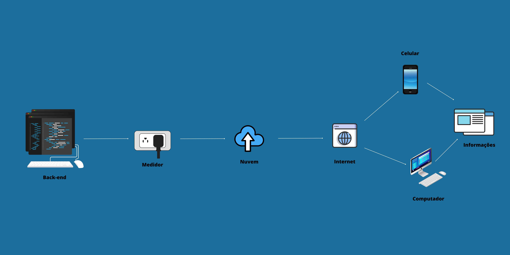

# MeterWatt ⚡ 
**Projeto Finalista NEXT FIAP 2023**

O MeterWatt é um sistema de monitoramento de energia inteligente (IoT) desenvolvido para medir o consumo em tempo real, gerando dashboards interativos para análise de eficiência energética e controle de gastos.

## 📖 Visão e Propósito

O **MeterWatt** nasceu da necessidade de transformar a relação entre consumidores e o consumo elétrico, promovendo conscientização e eficiência operacional. A solução está fundamentada em quatro pilares estratégicos:

*   **🏠 Conscientização Residencial:** Permite que o usuário identifique com precisão quais dispositivos estão elevando a conta de luz, facilitando a gestão de uma *Smart Home* com controle total de gastos e consumo.
*   **🛡️ Segurança e Detecção de Falhas:** O monitoramento contínuo possibilita a identificação precoce de fugas de energia, falhas em fiações antigas ou possíveis curto-circuitos, atuando diretamente na prevenção de acidentes domésticos e industriais.
*   **📉 Combate a Perdas Não Técnicas (Gatos):** No mercado de baixa tensão, as perdas não técnicas (furtos e fraudes) atingiram **16,02%** em 2024, gerando um prejuízo nacional de **R$ 10,3 bilhões**, segundo dados da ANEEL. O MeterWatt atua na detecção dessas anomalias em tempo real, auxiliando empresas e concessionárias a identificar desvios que chegam a elevar as tarifas em até **13,4%** para o consumidor final.
*   **🏛️ Integração Governamental:** A proposta inclui uma camada de conectividade para que governos e concessionárias acessem dados precisos sobre a demanda e produção de energia, otimizando a distribuição e o planejamento energético em nível municipal e estadual.

> **Status:** protótipo em testes. Os itens da visão acima (detecção de fraudes, integração com concessionárias e governo) ainda **não estão implementados**.

## 📂 Estrutura do Repositório

*   [**📁 firmware/mwatt_pzem**](./firmware/mwatt_pzem): firmware do ESP32 com o **PZEM-004T v3.0**. Mede tensão, corrente, potência ativa, energia, frequência e fator de potência.
*   [**📁 firmware/mwatt**](./firmware/mwatt): firmware anterior, com o sensor de corrente ACS712. Só mede corrente (potência aparente estimada).
*   [**📁 src**](./src): backend em Python. Recebe as leituras por MQTT, grava um CSV e serve o **painel web** e a API.
*   [**📁 tools**](./tools): simulador de PZEM, para testar tudo sem o hardware.
*   [**📁 android**](./android): gera o app Android da Play Store a partir do site (compilado pelo GitHub).
*   [**📁 tests**](./tests): testes automáticos do backend e do protocolo do PZEM.
*   [**📁 docs**](./docs): documentação e imagens do projeto.

## 🚀 Tecnologias Utilizadas
* **Hardware:** NodeMCU-ESP32 DevKit V1 com PZEM-004T v3.0 (ou com o sensor de corrente ACS712 30 A).
* **Linguagens:** C++ (firmware), Python (backend) e HTML/CSS/JavaScript puro (painel).
* **Protocolos:** Modbus RTU (ESP32 e PZEM), MQTT com usuário e senha (telemetria) e HTTP (painel e API).

## 📋 O que funciona hoje

| | PZEM-004T v3.0 (`firmware/mwatt_pzem`) | ACS712 (`firmware/mwatt`) |
|---|---|---|
| Tensão, frequência, fator de potência | medidos | não mede |
| Potência | ativa, em **W** | aparente, em **VA**, com tensão fixa |
| Consumo | **kWh** do contador do módulo | estimativa |
| Custo em reais | kWh × tarifa informada | estimativa |

* Painel web em `http://localhost:5000/`, com gráfico, consumo do dia e saúde do medidor.
* O painel avisa quando o número é antigo (medidor sem sinal), estimado (ACS712) ou simulado.
* Cada leitura é gravada em `leituras.csv`.

> **Situação do firmware do PZEM:** o protocolo e o backend foram testados no computador, com um PZEM simulado. **Ele ainda não foi testado com o módulo real.** O primeiro teste de bancada está descrito mais abaixo.

**Limites:** o custo usa só a tarifa por kWh que você informa, sem impostos nem bandeira tarifária. O MeterWatt é informativo e não substitui o medidor da concessionária.

## ⚠️ Segurança

* A ligação do PZEM à rede elétrica (bornes de tensão e sensor de corrente) é trabalho de **eletricista**, com o disjuntor desligado e o módulo dentro de uma caixa fechada.
* O ESP32 liga **somente** no conector de 4 pinos do PZEM (5V, RX, TX, GND). Esse lado é isolado da rede por optoacopladores.
* Nunca ligue a rede elétrica direto no ESP32, nem por divisor de tensão.

## 🔌 Ligação do PZEM-004T v3.0

**Lado da rede (eletricista):** os dois bornes de tensão vão em paralelo com o circuito (fase e neutro, ou fase e fase em 220 V), depois de um disjuntor ou fusível. O sensor de corrente abraça **um fio só** (a fase), sem cortar nada. Siga a marcação impressa na placa do módulo.

**Lado do ESP32:** o conector serial do PZEM foi projetado para 5 V, e os pinos do ESP32 só aceitam 3,3 V. Há duas formas de ligar. As duas precisam ser confirmadas na bancada com o módulo em mãos.

*Opção A, sem soldar no módulo (recomendada):* use um conversor de nível lógico bidirecional (a plaquinha de 4 canais com BSS138).

| PZEM | Conversor de nível | ESP32 |
|---|---|---|
| 5V | HV | VIN (5 V do USB) |
| GND | GND | GND |
| TX | HV1 → LV1 | GPIO16 (RX2) |
| RX | HV2 → LV2 | GPIO17 (TX2) |
| | LV | 3V3 |

*Opção B, com solda no módulo:* alimentar o pino 5V do PZEM com o 3V3 do ESP32 e soldar um resistor de 1 kΩ em paralelo com o R8 da placa, como descreve a [documentação do Tasmota](https://tasmota.github.io/docs/PZEM-0XX/). Assim os sinais já ficam em 3,3 V e TX/RX ligam direto no GPIO16 e GPIO17. Só faça se tiver prática com solda SMD.

**Nunca** ligue o TX do PZEM alimentado em 5 V direto no GPIO16.

### Casa com duas ou três fases (firmware 3.4)

Um PZEM mede a corrente de **um fio só**. Numa casa bifásica, um PZEM só na fase 1 mede mais ou menos metade da casa. Para medir a entrada inteira, é **um PZEM por fase**: 2 na bifásica, 3 na trifásica. O tipo de ligação aparece na conta de luz ou no disjuntor geral (uma, duas ou três alavancas presas juntas), mas quem confirma é o eletricista.

**Lado da rede (eletricista):** cada PZEM com a pinça no fio de uma fase e os bornes de tensão entre **essa fase e o neutro**. Não use fase com fase aqui: a soma das fases só dá o total da casa quando cada módulo mede a sua fase contra o neutro. Assim os aparelhos de 220 V (entre duas fases, como o chuveiro) entram certo: aparecem divididos entre as duas fases, e a soma é o consumo deles.

**Lado do ESP32:** todos os PZEM no mesmo par de fios (GPIO16 e GPIO17), com o 5V e o GND em comum. Cada módulo precisa de um endereço diferente, gravado nele **antes** de juntar os fios:

1. Ligue só um PZEM na serial (e na rede, pelo eletricista: ele se alimenta dela).
2. Abra o Monitor Serial a 115200 e digite `endereco 1`. O firmware confirma lendo o módulo no endereço novo. Anote o número numa etiqueta no módulo.
3. Troque pelo próximo módulo e digite `endereco 2` (e `endereco 3` na trifásica).
4. No `config.h`, troque para `#define PZEM_ENDERECOS {0x01, 0x02}` (ou `{0x01, 0x02, 0x03}`), na ordem das fases, e grave o firmware.
5. Junte os módulos na serial e digite `procurar`: cada endereço precisa aparecer.

**A confirmar na bancada:** quem já ligou vários PZEM v3 no mesmo par de fios relata que o TX de cada módulo precisa passar por um **diodo Schottky** (BAT38 ou parecido, com a faixa virada para o TX do PZEM) e que a linha precisa de um resistor de pull-up ([relato com 3 PZEM e Tasmota](https://zorruno.com/2020/whole-house-3-phase-power-with-pzem-004t/)). A plaquinha conversora de nível BSS138 já tem pull-up do lado HV. Sem os diodos, as respostas podem chegar com erro de CRC. Teste com um módulo, depois com dois.

Com uma fase sem resposta (falta de energia nela, ou um fio solto), o medidor continua mandando as outras, o app mostra qual faltou e manda o aviso **Fase sem resposta** depois de 5 minutos. O consumo de cada fase é contado pelo contador dela: quando a fase volta, o que ela mediu no intervalo entra.

**Limite das fases:** o PZEM não mostra o sinal da potência. Um aparelho entre duas fases com fator de potência abaixo de 0,5 faria um dos módulos medir "ao contrário" e a soma sairia maior. Em casa isso é raro.

### Sem Wi-Fi, a medição não se perde (firmware 3.5)

Quando o Wi-Fi da casa ou o servidor cai, o medidor continua medindo e guarda um resumo por minuto (quantas leituras, potência média, mínima e máxima, e o contador de energia de cada fase). Cabem 12 horas, uns 26 KB da memória do ESP32. Quando a conexão volta, ele manda esses minutos antes das leituras ao vivo, e o servidor os coloca nos horários certos: o perfil do dia, o relatório e a conferência com a conta de luz ficam como se a conexão não tivesse caído. A tela do medidor mostra a última queda e quantos minutos voltaram.

- O horário de cada minuto vai como o tempo ligado da placa, e o servidor converte. Não precisa de relógio na placa.
- Os minutos vão no mesmo tópico da telemetria (`"tipo":"atrasadas"`): as permissões dos medidores no broker não mudam.
- Numa queda maior que 12 horas, ficam as 12 mais recentes. A energia do que não coube não se perde (o contador do PZEM continua contando), mas entra de uma vez no primeiro minuto guardado.
- Se a placa reiniciar sem conexão, os minutos guardados se perdem (ficam só na RAM). A energia entra de uma vez quando a conexão voltar.
- O Detetive de aparelhos não vê os minutos atrasados: ele precisa das leituras de segundo em segundo.

## 🧪 Como testar

### 1. Broker MQTT com senha (Mosquitto)
Instale o [Mosquitto](https://mosquitto.org/download/) no computador que vai receber os dados e crie um usuário:

```bash
mosquitto_passwd -c senhas.txt meterwatt
```

Crie um arquivo `mosquitto.conf`:

```
listener 1883
allow_anonymous false
password_file senhas.txt
```

E rode: `mosquitto -c mosquitto.conf -v`

### 2. Backend e painel
```bash
cd src
pip install -r requirements.txt
MQTT_USUARIO=meterwatt MQTT_SENHA=sua-senha TARIFA_KWH=0.95 python dashboard.py
```
No Windows (PowerShell), defina as variáveis com `$env:MQTT_USUARIO="meterwatt"` antes de rodar.
Use em `TARIFA_KWH` o valor por kWh da sua conta de luz. O 0.95 é só exemplo.

Abra **http://localhost:5000/** no navegador. Enquanto nenhum medidor enviar leituras, o painel mostra a tela de espera.

* `GET /api/dispositivos`: todos os medidores, com as medidas atuais.
* `GET /api/historico/<id>?minutos=30`: pontos do gráfico (ficam só na memória, até 2 horas).
* `GET /get` e `GET /dispositivos`: formato das versões anteriores, mantido.

Para abrir o painel pelo celular na mesma rede Wi-Fi, rode com `HTTP_HOST=0.0.0.0` e acesse `http://IP-DO-COMPUTADOR:5000/`. **O painel ainda não tem login.** Use só na rede de casa e nunca exponha essa porta à internet.

### 3. Simulador (sem hardware)
Com o broker e o backend rodando, em outro terminal:

```bash
MQTT_USUARIO=meterwatt MQTT_SENHA=sua-senha python tools/simulador_pzem.py
```

Ele publica as mesmas mensagens do firmware, com uma casa de mentira (geladeira, chuveiro, micro-ondas). Toda mensagem leva `"simulado": true`, e o painel mostra o aviso "Dados do simulador". Opções úteis: `--tensao 220`, `--acelerar 20` (o tempo da casa corre mais rápido), `--falhas` (simula o PZEM sem responder), `--fases 2` (casa bifásica, um PZEM por fase, com o chuveiro de 220 V entre as fases), `--sem-fase 2` (a fase 2 sem energia) e `--queda 300` (5 minutos sem conexão, guardando um resumo por minuto).

### 4. Firmware do PZEM
1. Copie `firmware/mwatt_pzem/config.example.h` para `firmware/mwatt_pzem/config.h`. O `config.h` está no `.gitignore` e **nunca deve ir para o GitHub**.
2. No `config.h`, troque a `SENHA_PORTAL` (de 8 a 63 caracteres). Os campos de MQTT servem só de ponto de partida.
3. Na Arduino IDE, instale as bibliotecas **PubSubClient** e **WiFiManager** (de tzapu), selecione a placa **ESP32 Dev Module** e grave. O protocolo do PZEM está em `pzem_modbus.h`, sem biblioteca.
4. Abra o Monitor Serial em 115200. Cada leitura aparece em JSON.

#### Configurar o Wi-Fi pelo celular (sem mexer no código)
1. Na primeira vez, o ESP32 cria a rede **MeterWatt-XXXX** (as 4 últimas letras do identificador). Conecte o celular nela com a `SENHA_PORTAL`.
2. A página de configuração abre sozinha. Se não abrir, acesse `192.168.4.1` no navegador.
3. Toque em **Configure WiFi**, escolha a rede da casa, digite a senha e preencha o servidor MQTT (o IP do computador com o broker), a porta, o usuário e a senha.
4. Salve. O ESP32 conecta na rede da casa e a rede MeterWatt-XXXX some. Os ajustes ficam guardados na memória da placa, mesmo sem energia.

A página nunca mostra senhas salvas: deixar um campo de senha em branco mantém a atual. Um formulário com algum campo inválido não muda nada, e o Monitor Serial diz qual campo estava errado.

**Para recomeçar do zero**, segure o botão **BOOT** da placa por 5 segundos. Ele apaga o Wi-Fi e os ajustes e reabre a página.

Para usar o jeito antigo, com o Wi-Fi escrito no `config.h`, coloque `USAR_PORTAL_WIFI 0`.

#### Atualizar o firmware pelo Wi-Fi
1. Defina uma senha de atualização (de 8 a 32 caracteres), na página de configuração ou em `OTA_SENHA` no `config.h`. Sem ela, a atualização pelo Wi-Fi fica desligada.
2. Com o ESP32 e o computador na mesma rede, na Arduino IDE, vá em **Ferramentas > Porta** e escolha a porta de rede `mw-...`.
3. Grave normalmente. A IDE pede a senha de atualização.

Se a atualização falhar no meio, o ESP32 continua com o firmware anterior. Mesmo assim, não desligue a placa durante a gravação.

### 5. Primeiro teste de bancada com o módulo real
1. **Só o ESP32, sem o PZEM.** O Monitor Serial deve mostrar `"sensor_ok":false,"erro_sensor":"sem_resposta"`, e o painel, "Sensor sem leitura". Isso é o esperado.
2. **PZEM ligado ao ESP32, ainda sem rede elétrica.** Continua `sem_resposta`: o módulo só responde quando está energizado pela rede.
3. **Com o eletricista, rede ligada e sem carga.** Devem aparecer a tensão e 0 A. Compare a tensão com um multímetro.
4. **Com uma carga resistiva conhecida** (chaleira ou ferro de passar). Compare a corrente com um alicate amperímetro True RMS e anote o erro. O fator de potência deve ficar perto de 1,00.
5. Se aparecer `crc_invalido` ou `resposta_incompleta`, o problema é a ligação serial (nível de tensão, fio solto ou TX e RX trocados).

Esse teste usa uma leitura por segundo (`INTERVALO_ENVIO_MS 1000`, o padrão do `config.example.h`). Quem copiou o `config.h` antes do PR #7 tem 5000 ali: troque para 1000, senão o painel atualiza a cada 5 s e o Detetive de aparelhos perde os aparelhos que ficam pouco tempo ligados.

### Calibração com a ferramenta
Com o backend rodando, num segundo terminal, na raiz do repositório:

```bash
python tools/calibrar.py anotar
```

Para cada carga, o programa marca sozinho o início e o fim da medição e pede os valores do multímetro e do alicate. Comece sem carga, depois use cargas resistivas (chaleira, ferro de passar). Deixe cada medição rodar por pelo menos 30 segundos.

Depois, para gerar o relatório:

```bash
python tools/calibrar.py relatorio
```

Ele cruza as leituras do backend (`src/leituras.csv`) com as medidas anotadas (`docs/calibracao-medidas.csv`) e escreve `docs/calibracao.md`, com o erro de cada carga e se ficou dentro da meta de 5%. Para outra meta, use `--meta 2`. Se as leituras forem do simulador, o relatório avisa que não vale como calibração.

### 6. Firmware do ACS712 (versão anterior)
1. Copie `firmware/mwatt/config.example.h` para `firmware/mwatt/config.h` e preencha.
2. Confira o `FATOR_DIVISOR`: o ACS712 alimentado em 5 V pode passar de 3,3 V na saída, e o ESP32 não aceita isso no pino.
3. **Ruído:** sem nenhuma carga, anote o maior `irms_a` que aparece. Coloque em `LIMIAR_RUIDO_A` um valor um pouco acima dele.
4. **Ganho:** com uma carga resistiva conhecida, calcule `AJUSTE_CALIBRACAO = corrente do alicate / irms_a do MeterWatt` e grave de novo.

### 7. Testes automáticos
```bash
pip install pytest pillow
python -m pytest tests -q
node tests/web/teste_economia.js        # contas do "E se eu…?" no navegador
g++ -std=c++11 -o teste_pzem tests/firmware/teste_pzem_modbus.cpp && ./teste_pzem
g++ -std=c++11 -o teste_fases tests/firmware/teste_fases.cpp && ./teste_fases
g++ -std=c++11 -o teste_fila tests/firmware/teste_fila_offline.cpp && ./teste_fila
g++ -std=c++11 -o teste_ajustes tests/firmware/teste_ajustes.cpp && ./teste_ajustes
```

Para rodar o firmware do PZEM num ESP32 simulado no computador (página de configuração, memória, falhas do sensor, dois PZEM no mesmo par de fios, queda do Wi-Fi): `bash tests/firmware/simulado/rodar.sh`.

O GitHub roda esses testes e **compila os dois firmwares para o ESP32** a cada pull request (aba *Actions*, arquivo `.github/workflows/ci.yml`). Se a compilação falhar ali, ela também falharia na Arduino IDE. A compilação usa o `config.example.h`: o `config.h` de verdade nunca vai para o GitHub.

## 👤 Aplicativo com contas (`src/meterwatt`)

O produto: cada cliente cria a conta, pareia o medidor e vê só os dados dele. O `src/dashboard.py` continua como **painel de bancada** (sem login, para calibrar na mesa).

```bash
pip install -r src/requirements.txt
cd src && python -m meterwatt            # http://localhost:8000
# em outro terminal, um medidor de mentira:
python tools/simulador_pzem.py --intervalo 1 --parear K7QM-2XPA   # código gerado em Medidores > Adicionar
```
Em desenvolvimento os e-mails (confirmação, senha) ficam em `src/instancia/caixa-de-saida/`. A pasta `instancia/` guarda o banco e a chave de desenvolvimento e nunca vai para o Git.

- **Segurança**: Argon2id, verificação em duas etapas (TOTP + códigos de backup), sessões no servidor, CSRF, limites de tentativas, CSP estrita. Detalhes em [`docs/seguranca.md`](docs/seguranca.md).
- **LGPD**: autorizações por finalidade com histórico, cópia dos dados, apagar consumo, excluir conta, atividade visível, retenção automática. Detalhes em [`docs/lgpd.md`](docs/lgpd.md).
- **Consumo fantasma**: quanto a casa gasta parada (madrugadas dos últimos 7 dias), em W, kWh e R$ por mês.
- **Meta do mês**: previsão da conta até o fim do mês e quanto dá para gastar por dia para caber.
- **Gráficos do painel**: *Para onde vai agora* divide o consumo do momento entre circuitos medidos, imóveis ou aparelhos (palpite do Detetive), "sempre ligado" e outros; *Perfil do dia* compara hoje, hora a hora, com o normal da casa (mediana dos dias do mesmo tipo nas últimas 4 semanas) e mostra um mapa de 14 dias; o número de agora aparece dentro de uma casa em 3D que muda de cor com a carga (dá para desligar no botão 3D). Os gráficos têm tabela e leitura pelo teclado. As contas estão em `graficos.py`.
- **A conta de verdade** (aba Economia e meta do mês): *Tarifa Branca: vale a pena?* divide o consumo das últimas 4 semanas, de meia em meia hora, entre ponta, intermediário e fora de ponta (dias úteis e feriados como na REN ANEEL 1.000/2021), compara com a convencional usando os preços da distribuidora que a pessoa informa, diz quanto tirar da ponta para empatar e quais aparelhos mais pesam nela (Detetive). A previsão da meta passa a somar a bandeira do mês (`python -m meterwatt --bandeira 2026-12 amarela`) e a respeitar o mínimo da ligação (30, 50 ou 100 kWh). As contas estão em `tarifas.py`.
- **Relatório do mês** (Painel, "Relatório do mês"): consumo e custo estimado do mês, dia a dia, comparação com o mês anterior pela média por dia, dia mais caro, dias úteis contra fim de semana, horário mais pesado, consumo em espera e aparelhos que mais gastaram (Detetive). Imprime ou salva em PDF pelo navegador e baixa os dias em planilha (CSV para o Excel em português). No dia 1º, o aviso "Resumo do mês" leva ao relatório. As contas estão em `relatorios.py`.
- **Compartilhar a casa** (Conta, "Compartilhar a casa"): convida alguém da família por e-mail para ver o painel e o relatório do mês, só para ler e sem o Detetive de aparelhos. O convite vale 7 dias e só a conta daquele e-mail aceita; quem compartilhou tira o acesso quando quiser. Quem vê outra casa troca de casa no alto do Painel. O servidor só aceita leituras numa lista fechada (`ROTAS_COMPARTILHADAS` em `web.py`); a regra está em `compartilhar.py`.
- **Conferir com a conta de luz** (aba Economia): a pessoa digita o período, o consumo faturado e o total de uma conta; o app compara com o que o MeterWatt mediu no mesmo período (até 3% de diferença: confere) e calcula a tarifa de verdade (total ÷ kWh), que pode passar a valer nas contas do app. As contas estão em `contas_luz.py`.
- **Vários medidores**: cada medidor diz o que mede, a **entrada** de um imóvel (soma no total) ou um **circuito** dentro de uma entrada (o ar-condicionado, a cozinha: não soma de novo). A pergunta aparece ao parear o segundo medidor e pode mudar em Medidores.
- **Pareamento**: firmware 3.2 tem o campo "Código de pareamento" na página de configuração (toque rápido no BOOT reabre a página).
- **Avisos e resumo semanal**: medidor sem sinal, meta, consumo fora do normal e um resumo toda segunda, no aplicativo, por e-mail e como notificação no celular (cada tipo escolhe os canais).
- **Detetive de aparelhos** (em teste): reconhece o que liga e desliga pelo degrau de potência. Precisa de autorização própria.
- **E se eu…?** (aba Economia): simulador de economia com os números da casa (banho mais curto, chuveiro na posição verão, consumo em espera, menos minutos de um aparelho, troca da geladeira). O que a pessoa marcar vira um plano, e depois de alguns dias o aplicativo confere na medição se a economia apareceu ("Deu certo?"). As contas estão em `economia.py` e, iguais, em `estatico/economia-calculo.js`; os dois passam pelos mesmos casos em `tests/economia_vetores.json`.
- **App no celular**: o site instala como app (ícone na tela inicial, tela cheia, abre sem internet) e manda os avisos como notificação, no Android, no iPhone (iOS 16.4+) e no computador. Guia em [`docs/app-celular.md`](docs/app-celular.md).
- **App da Play Store** (`android/`): o GitHub gera, compila e assina o app Android (Trusted Web Activity, Android 16) a partir do manifesto do site; a chave de envio fica nos segredos do repositório. Imagens da ficha em [`docs/play-store`](docs/play-store). Passo a passo em [`docs/app-celular.md`](docs/app-celular.md#play-store-android).
- **Ver o app funcionando**: modo demonstração com uma casa simulada, sem conta e sem gravar nada no servidor (botão nas telas de início e de entrada). Política, termos e exclusão da conta também abrem sem login em `/politica-de-privacidade`, `/termos-de-uso` e `/excluir-conta`.
- **Planos**: grátis com 1 medidor e plano Casa, com Mercado Pago em modo de teste (`MW_PAGAMENTO_PROVEDOR`). Em desenvolvimento há um pagamento de mentira.
- **Página inicial**: calculadora de consumo fantasma e lista de espera com convite (`python -m meterwatt --lista-espera`).
- **Senha própria por medidor** e conexão criptografada (firmware 3.3 + Mosquitto com dynamic-security).
- **Backup cifrado**: `python -m meterwatt --backup` e `--restaurar ARQUIVO`.
- Produção: veja [`docs/implantacao.md`](docs/implantacao.md) (Docker) e `infra/`.
- Testes: `python -m pytest tests -q` (com `pip install pytest pillow`) e `node tests/web/teste_economia.js`.
- Ensaio geral sem placa: `python tools/ensaio_completo.py` sobe um Mosquitto com dynamic-security e a porta 8883 criptografada, o aplicativo com `python -m meterwatt` e dois medidores simulados (um deles bifásico), e confere o caminho inteiro (pareamento, fases, senha própria, painel, circuito, permissões no broker, medidor que cai, remoção, cópia dos dados e backup). Roda também no GitHub a cada PR. Precisa do Mosquitto 2 (Linux, macOS ou WSL).
- Demonstração em um arquivo só, com uma casa inventada: `python tools/gerar_demo.py` (abre com dois cliques, nada sai do navegador).

## 🏆 Reconhecimento
Este projeto foi selecionado como **finalista no NEXT FIAP 2023**, sendo avaliado por sua viabilidade técnica e impacto em sustentabilidade.


---
**Desenvolvido por:** [Adriano Lopes Santana](https://www.linkedin.com/in/adriano-lopes-santana-352692293)
**Instituição:** FIAP - Engenharia de Software.
