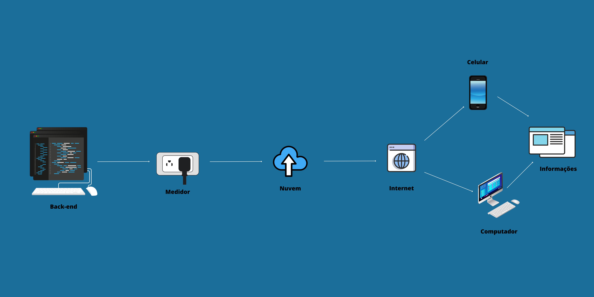

# MeterWatt ⚡ 
**Projeto Finalista NEXT FIAP 2023**

O MeterWatt é um sistema de monitoramento de energia inteligente (IoT) desenvolvido para medir o consumo em tempo real, gerando dashboards interativos para análise de eficiência energética e controle de gastos.

## 📖 Visão e Propósito

O **MeterWatt** nasceu da necessidade de transformar a relação entre consumidores e o consumo elétrico, promovendo conscientização e eficiência operacional. A solução está fundamentada em quatro pilares estratégicos:

*   **🏠 Conscientização Residencial:** Permite que o usuário identifique com precisão quais dispositivos estão elevando a conta de luz, facilitando a gestão de uma *Smart Home* com controle total de gastos e consumo.
*   **🛡️ Segurança e Detecção de Falhas:** O monitoramento contínuo possibilita a identificação precoce de fugas de energia, falhas em fiações antigas ou possíveis curto-circuitos, atuando diretamente na prevenção de acidentes domésticos e industriais.
*   **📉 Combate a Perdas Não Técnicas (Gatos):** No mercado de baixa tensão, as perdas não técnicas (furtos e fraudes) atingiram **16,02%** em 2024, gerando um prejuízo nacional de **R$ 10,3 bilhões**, segundo dados da ANEEL. O MeterWatt atua na detecção dessas anomalias em tempo real, auxiliando empresas e concessionárias a identificar desvios que chegam a elevar as tarifas em até **13,4%** para o consumidor final.
*   **🏛️ Integração Governamental:** A proposta inclui uma camada de conectividade para que governos e concessionárias acessem dados precisos sobre a demanda e produção de energia, otimizando a distribuição e o planejamento energético em nível municipal e estadual.

> **Status:** protótipo em testes. Os itens da visão acima (detecção de fraudes, integração com concessionárias e governo) ainda **não estão implementados**.

## 📂 Estrutura do Repositório

*   [**📁 firmware/mwatt_pzem**](./firmware/mwatt_pzem): firmware do ESP32 com o **PZEM-004T v3.0**. Mede tensão, corrente, potência ativa, energia, frequência e fator de potência.
*   [**📁 firmware/mwatt**](./firmware/mwatt): firmware anterior, com o sensor de corrente ACS712. Só mede corrente (potência aparente estimada).
*   [**📁 src**](./src): backend em Python. Recebe as leituras por MQTT, grava um CSV e serve o **painel web** e a API.
*   [**📁 tools**](./tools): simulador de PZEM, para testar tudo sem o hardware.
*   [**📁 tests**](./tests): testes automáticos do backend e do protocolo do PZEM.
*   [**📁 docs**](./docs): documentação e imagens do projeto.

## 🚀 Tecnologias Utilizadas
* **Hardware:** NodeMCU-ESP32 DevKit V1 com PZEM-004T v3.0 (ou com o sensor de corrente ACS712 30 A).
* **Linguagens:** C++ (firmware), Python (backend) e HTML/CSS/JavaScript puro (painel).
* **Protocolos:** Modbus RTU (ESP32 e PZEM), MQTT com usuário e senha (telemetria) e HTTP (painel e API).

## 📋 O que funciona hoje

| | PZEM-004T v3.0 (`firmware/mwatt_pzem`) | ACS712 (`firmware/mwatt`) |
|---|---|---|
| Tensão, frequência, fator de potência | medidos | não mede |
| Potência | ativa, em **W** | aparente, em **VA**, com tensão fixa |
| Consumo | **kWh** do contador do módulo | estimativa |
| Custo em reais | kWh × tarifa informada | estimativa |

* Painel web em `http://localhost:5000/`, com gráfico, consumo do dia e saúde do medidor.
* O painel avisa quando o número é antigo (medidor sem sinal), estimado (ACS712) ou simulado.
* Cada leitura é gravada em `leituras.csv`.

> **Situação do firmware do PZEM:** o protocolo e o backend foram testados no computador, com um PZEM simulado. **Ele ainda não foi testado com o módulo real.** O primeiro teste de bancada está descrito mais abaixo.

**Limites:** o custo usa só a tarifa por kWh que você informa, sem impostos nem bandeira tarifária. O MeterWatt é informativo e não substitui o medidor da concessionária.

## ⚠️ Segurança

* A ligação do PZEM à rede elétrica (bornes de tensão e sensor de corrente) é trabalho de **eletricista**, com o disjuntor desligado e o módulo dentro de uma caixa fechada.
* O ESP32 liga **somente** no conector de 4 pinos do PZEM (5V, RX, TX, GND). Esse lado é isolado da rede por optoacopladores.
* Nunca ligue a rede elétrica direto no ESP32, nem por divisor de tensão.

## 🔌 Ligação do PZEM-004T v3.0

**Lado da rede (eletricista):** os dois bornes de tensão vão em paralelo com o circuito (fase e neutro, ou fase e fase em 220 V), depois de um disjuntor ou fusível. O sensor de corrente abraça **um fio só** (a fase), sem cortar nada. Siga a marcação impressa na placa do módulo.

**Lado do ESP32:** o conector serial do PZEM foi projetado para 5 V, e os pinos do ESP32 só aceitam 3,3 V. Há duas formas de ligar. As duas precisam ser confirmadas na bancada com o módulo em mãos.

*Opção A, sem soldar no módulo (recomendada):* use um conversor de nível lógico bidirecional (a plaquinha de 4 canais com BSS138).

| PZEM | Conversor de nível | ESP32 |
|---|---|---|
| 5V | HV | VIN (5 V do USB) |
| GND | GND | GND |
| TX | HV1 → LV1 | GPIO16 (RX2) |
| RX | HV2 → LV2 | GPIO17 (TX2) |
| | LV | 3V3 |

*Opção B, com solda no módulo:* alimentar o pino 5V do PZEM com o 3V3 do ESP32 e soldar um resistor de 1 kΩ em paralelo com o R8 da placa, como descreve a [documentação do Tasmota](https://tasmota.github.io/docs/PZEM-0XX/). Assim os sinais já ficam em 3,3 V e TX/RX ligam direto no GPIO16 e GPIO17. Só faça se tiver prática com solda SMD.

**Nunca** ligue o TX do PZEM alimentado em 5 V direto no GPIO16.

## 🧪 Como testar

### 1. Broker MQTT com senha (Mosquitto)
Instale o [Mosquitto](https://mosquitto.org/download/) no computador que vai receber os dados e crie um usuário:

```bash
mosquitto_passwd -c senhas.txt meterwatt
```

Crie um arquivo `mosquitto.conf`:

```
listener 1883
allow_anonymous false
password_file senhas.txt
```

E rode: `mosquitto -c mosquitto.conf -v`

### 2. Backend e painel
```bash
cd src
pip install -r requirements.txt
MQTT_USUARIO=meterwatt MQTT_SENHA=sua-senha TARIFA_KWH=0.95 python dashboard.py
```
No Windows (PowerShell), defina as variáveis com `$env:MQTT_USUARIO="meterwatt"` antes de rodar.
Use em `TARIFA_KWH` o valor por kWh da sua conta de luz. O 0.95 é só exemplo.

Abra **http://localhost:5000/** no navegador. Enquanto nenhum medidor enviar leituras, o painel mostra a tela de espera.

* `GET /api/dispositivos`: todos os medidores, com as medidas atuais.
* `GET /api/historico/<id>?minutos=30`: pontos do gráfico (ficam só na memória, até 2 horas).
* `GET /get` e `GET /dispositivos`: formato das versões anteriores, mantido.

Para abrir o painel pelo celular na mesma rede Wi-Fi, rode com `HTTP_HOST=0.0.0.0` e acesse `http://IP-DO-COMPUTADOR:5000/`. **O painel ainda não tem login.** Use só na rede de casa e nunca exponha essa porta à internet.

### 3. Simulador (sem hardware)
Com o broker e o backend rodando, em outro terminal:

```bash
MQTT_USUARIO=meterwatt MQTT_SENHA=sua-senha python tools/simulador_pzem.py
```

Ele publica as mesmas mensagens do firmware, com uma casa de mentira (geladeira, chuveiro, micro-ondas). Toda mensagem leva `"simulado": true`, e o painel mostra o aviso "Dados do simulador". Opções úteis: `--tensao 220`, `--acelerar 20` (o tempo da casa corre mais rápido) e `--falhas` (simula o PZEM sem responder).

### 4. Firmware do PZEM
1. Copie `firmware/mwatt_pzem/config.example.h` para `firmware/mwatt_pzem/config.h`. O `config.h` está no `.gitignore` e **nunca deve ir para o GitHub**.
2. No `config.h`, troque a `SENHA_PORTAL` (de 8 a 63 caracteres). Os campos de MQTT servem só de ponto de partida.
3. Na Arduino IDE, instale as bibliotecas **PubSubClient** e **WiFiManager** (de tzapu), selecione a placa **ESP32 Dev Module** e grave. O protocolo do PZEM está em `pzem_modbus.h`, sem biblioteca.
4. Abra o Monitor Serial em 115200. Cada leitura aparece em JSON.

#### Configurar o Wi-Fi pelo celular (sem mexer no código)
1. Na primeira vez, o ESP32 cria a rede **MeterWatt-XXXX** (as 4 últimas letras do identificador). Conecte o celular nela com a `SENHA_PORTAL`.
2. A página de configuração abre sozinha. Se não abrir, acesse `192.168.4.1` no navegador.
3. Toque em **Configure WiFi**, escolha a rede da casa, digite a senha e preencha o servidor MQTT (o IP do computador com o broker), a porta, o usuário e a senha.
4. Salve. O ESP32 conecta na rede da casa e a rede MeterWatt-XXXX some. Os ajustes ficam guardados na memória da placa, mesmo sem energia.

A página nunca mostra senhas salvas: deixar um campo de senha em branco mantém a atual. Um formulário com algum campo inválido não muda nada, e o Monitor Serial diz qual campo estava errado.

**Para recomeçar do zero**, segure o botão **BOOT** da placa por 5 segundos. Ele apaga o Wi-Fi e os ajustes e reabre a página.

Para usar o jeito antigo, com o Wi-Fi escrito no `config.h`, coloque `USAR_PORTAL_WIFI 0`.

#### Atualizar o firmware pelo Wi-Fi
1. Defina uma senha de atualização (de 8 a 32 caracteres), na página de configuração ou em `OTA_SENHA` no `config.h`. Sem ela, a atualização pelo Wi-Fi fica desligada.
2. Com o ESP32 e o computador na mesma rede, na Arduino IDE, vá em **Ferramentas > Porta** e escolha a porta de rede `mw-...`.
3. Grave normalmente. A IDE pede a senha de atualização.

Se a atualização falhar no meio, o ESP32 continua com o firmware anterior. Mesmo assim, não desligue a placa durante a gravação.

### 5. Primeiro teste de bancada com o módulo real
1. **Só o ESP32, sem o PZEM.** O Monitor Serial deve mostrar `"sensor_ok":false,"erro_sensor":"sem_resposta"`, e o painel, "Sensor sem leitura". Isso é o esperado.
2. **PZEM ligado ao ESP32, ainda sem rede elétrica.** Continua `sem_resposta`: o módulo só responde quando está energizado pela rede.
3. **Com o eletricista, rede ligada e sem carga.** Devem aparecer a tensão e 0 A. Compare a tensão com um multímetro.
4. **Com uma carga resistiva conhecida** (chaleira ou ferro de passar). Compare a corrente com um alicate amperímetro True RMS e anote o erro. O fator de potência deve ficar perto de 1,00.
5. Se aparecer `crc_invalido` ou `resposta_incompleta`, o problema é a ligação serial (nível de tensão, fio solto ou TX e RX trocados).

Para esse teste, grave o firmware com `INTERVALO_ENVIO_MS 1000` no `config.h` (uma leitura por segundo).

### Calibração com a ferramenta
Com o backend rodando, num segundo terminal, na raiz do repositório:

```bash
python tools/calibrar.py anotar
```

Para cada carga, o programa marca sozinho o início e o fim da medição e pede os valores do multímetro e do alicate. Comece sem carga, depois use cargas resistivas (chaleira, ferro de passar). Deixe cada medição rodar por pelo menos 30 segundos.

Depois, para gerar o relatório:

```bash
python tools/calibrar.py relatorio
```

Ele cruza as leituras do backend (`src/leituras.csv`) com as medidas anotadas (`docs/calibracao-medidas.csv`) e escreve `docs/calibracao.md`, com o erro de cada carga e se ficou dentro da meta de 5%. Para outra meta, use `--meta 2`. Se as leituras forem do simulador, o relatório avisa que não vale como calibração.

### 6. Firmware do ACS712 (versão anterior)
1. Copie `firmware/mwatt/config.example.h` para `firmware/mwatt/config.h` e preencha.
2. Confira o `FATOR_DIVISOR`: o ACS712 alimentado em 5 V pode passar de 3,3 V na saída, e o ESP32 não aceita isso no pino.
3. **Ruído:** sem nenhuma carga, anote o maior `irms_a` que aparece. Coloque em `LIMIAR_RUIDO_A` um valor um pouco acima dele.
4. **Ganho:** com uma carga resistiva conhecida, calcule `AJUSTE_CALIBRACAO = corrente do alicate / irms_a do MeterWatt` e grave de novo.

### 7. Testes automáticos
```bash
pip install pytest
python -m pytest tests -q
g++ -std=c++11 -o teste_pzem tests/firmware/teste_pzem_modbus.cpp && ./teste_pzem
g++ -std=c++11 -o teste_ajustes tests/firmware/teste_ajustes.cpp && ./teste_ajustes
```

Para rodar o firmware do PZEM num ESP32 simulado no computador (página de configuração, memória, falhas do sensor): `bash tests/firmware/simulado/rodar.sh`.

O GitHub roda esses testes e **compila os dois firmwares para o ESP32** a cada pull request (aba *Actions*, arquivo `.github/workflows/ci.yml`). Se a compilação falhar ali, ela também falharia na Arduino IDE. A compilação usa o `config.example.h`: o `config.h` de verdade nunca vai para o GitHub.

## 👤 Aplicativo com contas (`src/meterwatt`)

O produto: cada cliente cria a conta, pareia o medidor e vê só os dados dele. O `src/dashboard.py` continua como **painel de bancada** (sem login, para calibrar na mesa).

```bash
pip install -r src/requirements.txt
cd src && python -m meterwatt            # http://localhost:8000
# em outro terminal, um medidor de mentira:
python tools/simulador_pzem.py --intervalo 1 --parear K7QM-2XPA   # código gerado em Medidores > Adicionar
```
Em desenvolvimento os e-mails (confirmação, senha) ficam em `src/instancia/caixa-de-saida/`. A pasta `instancia/` guarda o banco e a chave de desenvolvimento e nunca vai para o Git.

- **Segurança**: Argon2id, verificação em duas etapas (TOTP + códigos de backup), sessões no servidor, CSRF, limites de tentativas, CSP estrita. Detalhes em [`docs/seguranca.md`](docs/seguranca.md).
- **LGPD**: autorizações por finalidade com histórico, cópia dos dados, apagar consumo, excluir conta, atividade visível, retenção automática. Detalhes em [`docs/lgpd.md`](docs/lgpd.md).
- **Consumo fantasma**: quanto a casa gasta parada (madrugadas dos últimos 7 dias), em W, kWh e R$ por mês.
- **Meta do mês**: previsão da conta até o fim do mês e quanto dá para gastar por dia para caber.
- **Pareamento**: firmware 3.2 tem o campo "Código de pareamento" na página de configuração (toque rápido no BOOT reabre a página).
- Produção: veja `src/meterwatt/.env.exemplo` e `infra/mosquitto-acl.exemplo`.
- Testes: `python -m pytest tests -q`.

## 🏆 Reconhecimento
Este projeto foi selecionado como **finalista no NEXT FIAP 2023**, sendo avaliado por sua viabilidade técnica e impacto em sustentabilidade.


---
**Desenvolvido por:** [Adriano Lopes Santana](https://www.linkedin.com/in/adriano-lopes-santana-352692293)
**Instituição:** FIAP - Engenharia de Software.
